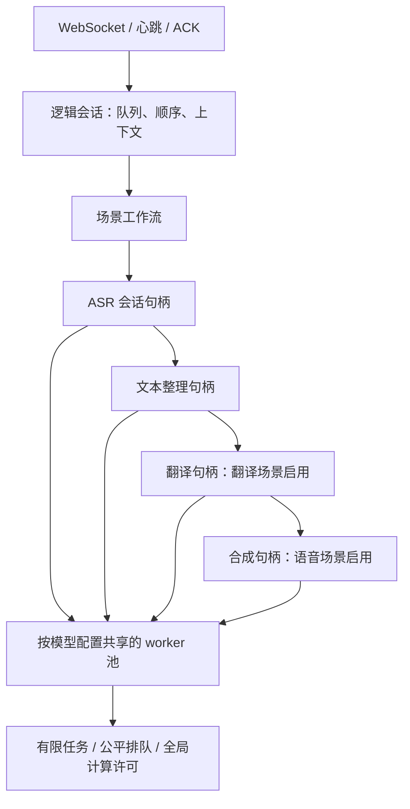

# 流式语音处理：接口与安装

## 范围与可用性

提供三种模式：`transcription`（原文字幕）、`translated_subtitles`（译文字幕）、`spoken_interpretation`（译文语音）。源语言必须指定 `zh` 或 `en`；翻译目标必须是另一个语言。WebSocket、能力查询和浏览器入口默认可用；具体场景是否就绪取决于所需模型和运行时，可通过 capabilities 查询。既有一次性接口保持原语义，在线 ASR 模型不能作为一次性 ASR 使用。

使用正常 `smartvoice --port 8766` 入口即可访问流式功能，不需要启用配置或环境变量。若直接启动 Uvicorn，配置 `--ws-max-size 32768 --ws-max-queue 8`。旧版 `smartvoice.json` 中的 `streaming_enabled` 项会被忽略。服务启动和会话创建不会下载模型。WebSocket 服务端依赖随基础包安装。翻译阶段需要 CTranslate2 和 SentencePiece，使用项目的 `streaming` extra 安装；模型离线转换还需要 `model-preparation` extra。

中文在线 ASR 使用 Paraformer，英文使用 Zipformer English；标点使用 CT-Transformer。中→英使用 OPUS-MT，英→中使用 M2M100。英文语音为 Supertonic 3，中文为 Matcha；中文中的拉丁词读音需要声明的 Kokoro 回退资产。依赖、资产和语言方向须在收音前验证。

模型管理分为 STT、TTS、Streaming 三个同级分类。流式专用 ID 使用 `streaming-stt-*`（在线识别）、`streaming-mt-*`（翻译）、`streaming-ct-*`（文本标点）；共用 TTS 保留 `tts-*`，只安装一份。`models list --category streaming` 查看专用模型；REST 的 `/v1/models?category=streaming` 列出已验证安装资产，`/v1/catalog?category=streaming` 包含未安装模型。前者的 `runtime_check_required` 不等于链路可用，仍需查询流式 capabilities。

所有目录模型均支持 `models install MODEL_ID`，`models install all` 包含流式模型及语言检测器。翻译模型在安装阶段下载固定源文件、校验 SHA-256、离线转换到 int8，再核对固定产物 SHA-256；需安装 `model-preparation` extra。缺少或版本不匹配时明确报错，全量安装在开始下载前检查这些依赖。启动/推理不下载或转换模型。已有旧 ID、目录和离线包可继续识别；列表和处理计划统一返回新 ID，新安装/导出使用新命名。

访问 `/console/streaming` 选择三个场景、语言和音频文件。页面支持实时重放、修订字幕、按顺序播放译文语音和动态首输出指标；当前没有麦克风采集 UI。SDK 可发送实时 PCM。先查询 `GET /v1/audio/stream/capabilities`；兼容字段 `enabled` 固定为 `true`，还需确认所选链路的 `available`，并考虑即时容量限制。

## 最小安装与启动流程

在项目根目录、已创建的 Python 虚拟环境中执行：

```sh
python -m pip install -e .
# 使用独立数据目录；安装、导入、启动都使用同一个 SMARTVOICE_HOME。
export SMARTVOICE_HOME="$PWD/.smartvoice-dev/streaming"
python -m smartvoice models list
python -m smartvoice models install streaming-stt-paraformer-zh-en-int8
python -m smartvoice models install streaming-stt-zipformer-en-int8
python -m smartvoice models install streaming-ct-transformer-zh-en
```

以上三个模型支持双语原文字幕。翻译模型直接安装：

```sh
python -m pip install -e '.[streaming,model-preparation]'
python -m smartvoice models install streaming-mt-opus-zh-en-int8
python -m smartvoice models install streaming-mt-m2m100-zh-en-int8
# 全量安装所有目录模型及语言检测器：
# python -m smartvoice models install all
```

只试一个方向时，只需安装对应翻译模型。离线部署仍可用 `models export/import`；已有准备好的 tokenizer/CT2 目录可通过 `scripts/prepare_streaming_bundle.py MODEL_ID --root /prepared/tree --output /tmp/model.zip` 打包后导入。该打包脚本只校验和打包，不下载或转换，不能覆盖已有输出包。

语音模式再安装目标语言 TTS 及声明的回退：

```sh
python -m smartvoice models install tts-supertonic-v3-multilingual-int8
python -m smartvoice models install tts-matcha-zh-baker
python -m smartvoice models install tts-kokoro-multilingual-v1-1-zh-en
python -m smartvoice --host 127.0.0.1 --port 8766
```

另一个终端查询能力，浏览器访问 `http://127.0.0.1:8766/console/streaming`：

```sh
curl http://127.0.0.1:8766/v1/audio/stream/capabilities
```

检查所需链路的 `available` 和 `missing_models`。`available` 不代表质量已验收，也不保证当前还有空闲会话容量。

| 模式 | configure.mode | 输入源语言 | 目标语言 | 额外阶段 |
|---|---|---|---|---|
| 原文字幕 | transcription | zh / en | 不填写 | 在线 ASR、标点 |
| 译文字幕 | translated_subtitles | zh / en | en / zh | 对应方向翻译 |
| 译文语音 | spoken_interpretation | zh / en | en / zh | 对应方向翻译、目标 TTS |

## smartvoice.stream.v1

连接 `WS /v1/audio/stream`，第一条消息是 JSON：

```json
{"type":"configure","protocol":"smartvoice.stream.v1","mode":"spoken_interpretation","source_language":"en","target_language":"zh","audio":{"encoding":"pcm_s16le","sample_rate":16000,"channels":1},"output_consumption":"playback","ack_window":16}
```

原文字幕省略 `target_language`。可选字段：`models`（asr/formatting/translation/tts 的活动阶段 ID）、`include_source_text`、`glossary`、`context`、`output_consumption`、`ack_window`、`resumable`。未知字段或不兼容配置被拒绝；`session_ready.plan` 返回已解析模型、策略和提交语义。等待 ready 后发送二进制 PCM16 little-endian，16kHz 单声道，建议每帧 20ms（640 字节），最多 32000 字节。不是上传 WAV/MP3 容器。输入结束发送 `{"type":"finish"}`；取消发送 `{"type":"cancel"}`。未启用恢复时直接发送 PCM；启用恢复时使用下面的帧头协议。

事件包含 `session_id`、递增 `event_sequence` 和服务端单调时间。`source_partial/source_final` 是声学段；显示字幕使用 `source_unit_partial/source_unit_final`；翻译为 `target_partial/target_final`。客户端按 unit/revision 替换草稿，接受显式撤回，忽略过期修订；final 是提交后的不可变文本。目标事件的源引用提供来源范围，不代表模型级逐词对齐。

`audio_segment` 是 JSON 描述符，紧接一条二进制 WAV；两条消息共同构成该音频块。校验 `audio_bytes`、`audio_sequence` 和目标文本区间，严格按序解码/播放。不能等整段输入结束才播放。`audio_skipped` 明确报告未播出的原因；客户端不能把它视为成功音频。TTS 只消费已提交且质量策略允许的文本。

用户明确结束输入时，最后一个已提交译文即使源句边界仍标为不完整，也会作为终端尾句播报，并在 `audio_segment.source_unit_incomplete=true` 中保留该事实。会话中途由 ASR 强制切分产生的不完整片段仍等待可确认的完整前缀；无法确认时发送 `audio_skipped(reason=incomplete)`，不会提前合成半句。任何翻译质量问题仍按原策略跳过。

对非终止 JSON 事件发送 `{"type":"ack","event_sequence":N}`；音频在接收完整二进制块后 ACK。`delivery` 模式仅确认消费；`playback` 模式还需按块顺序发送 `audio_started` 和 `audio_played`（字段 `audio_sequence`），用于播放积压控制。投递 ACK 不等于播放结束，定时调度也不等于物理可听时间。

### 同进程断线续传

浏览器页面已默认请求恢复，并在同一页面内自动重连；SDK 需在 configure 中显式设置
`"resumable":true`。原有客户端默认仍在断线时结束会话。先检查 capabilities 的
`resumption`，保存 `session_ready.session_id` 与 `session_ready.recovery.resume_token`。
token 是会话恢复凭证，应只保存在客户端私有状态，不放进 URL、日志或共享报告。

恢复模式每个二进制 PCM 帧前发送一个 JSON 帧头：

```json
{"type":"audio_frame","sequence":1,"start_sample":0}
```

序号从 1 起连续递增，`start_sample` 是整个会话的累计采样偏移；帧头后紧接 PCM，
不能夹其他控制消息。服务端返回无 `event_sequence` 的控制消息：

```json
{"type":"input_ack","input_sequence":1,"accepted_samples":320}
```

这表示已接收进会话输入队列，不代表模型已处理完成。客户端有界保留未确认 PCM，
丢失 ACK 时可重发：服务端核对最近 128 帧的序号、偏移、长度及内容 SHA256，
相同帧不再次送入 ASR；不同内容、窗口外旧帧或序号/采样缺口明确报错。
浏览器最多保留 32 个未确认的 20ms 帧，断线时暂停文件输入，恢复后继续按实时节奏发送。
实时麦克风接入需自行定义有界离线缓冲；不能无限积累断线期间的录音。

新 WebSocket 的第一条消息为：

```json
{"type":"resume","protocol":"smartvoice.stream.v1","session_id":"<session-id>","resume_token":"<private-token>","last_event_sequence":12,"last_audio_played":2}
```

`last_event_sequence` 是客户端已完整消费并保存的连续事件位置，音频必须收齐描述符与
二进制后才推进；先保存游标再发送 ACK，不能因重连回退到服务端已确认位置之前。
`last_audio_played` 为完整播完且客户端已记录的连续音频块序号；非 playback 消费模式填 0。
服务端校验游标、补齐丢失的播完通知，返回无事件序号的 `session_resumed`，包含
`input_sequence`、`accepted_samples`、`input_finished`、`last_event_sequence`、
`last_audio_played`、`context_version`、原 plan 和心跳间隔。

随后重放未确认输出及尚未播完的音频块，保持原来的 session/event/audio ID。
客户端按 ID 去重；已播完的块不重播。重连前停止未完成的播放队列，未播完的块按整块
重新播放，因此中断在块中间可能重复听到该块的一部分。恢复后按服务端输入游标继续
发送未接收的 PCM；输入已结束时不再发送新帧。恢复模式的 `finish` 可重复发送。
包括 `session_complete/error` 在内的终态事件也需要 ACK，避免终态消息丢失后无法重取。

默认 `streaming_resume_grace_seconds=20`，宽限期内保留原在线 ASR stream、上下文、
未排空输入及输出状态，会话仍占准入名额；不会重载模型或把 ASR 状态迁移到其他 worker。
输出缓存最多 128 个普通事件、8MiB，另预留一个终态事件；超限明确报错，不能静默漏段。
宽限到期、显式 cancel 或关服释放恢复状态；模型执行与播放排空截止时间仍有效，
恢复不能修复模型崩溃。`resume_unavailable`、`resume_in_use`、`resume_cursor_invalid`、
`audio_gap`、`audio_replay_conflict` 和 `resume_buffer_overload` 是主要错误。

该功能只支持原服务进程仍存活、原客户端状态仍保留的重连；不支持服务重启、跨实例
恢复或刷新页面后的自动续传，也不保证物理播放的精确一次。传输 token 不替代部署鉴权。

成功、部分完成、无音频、无语音或取消以一个 `session_complete` 终止；失败以一个 `error` 终止（含 code、stage/诊断信息）。错误与 complete 不应同时出现。客户端应读取 terminal.status，而不是仅凭连接关闭判断成功。阶段失败 error 事件包含已收集的 profiling、首输出和事件计数；建会话前的协议错误没有阶段 profiling。规范错误涵盖 invalid_config、invalid_message、unsupported_language_pair、model_unavailable、session_overload、memory_admission、scheduler_overload 及阶段超时/执行失败。

## 容错、资源与计时

默认会话上限 2、模型驻留预算 8192MiB（8GiB）、共享推理许可 2。连接数与执行中的推理任务分别受限：同模型、同线程配置复用一个原生进程，不会为每个会话重新加载模型；在线 ASR stream、前处理和动态上下文仍由每个会话独立持有。默认最多 8 个模型 worker，每个 worker 最多 32 个等待任务；缓存的模型在无会话使用 60 秒后回收，预算不足时先回收空闲模型。模型预算是准入估算，不是 RSS 硬限制。

初始化限时 30s、单次原生调用 15s。`streaming_lifetime_seconds=0` 默认不设会话墙钟上限；`streaming_max_audio_seconds=0` 默认不设累计音频上限，两者独立配置。设置有限时长仍可用于受控部署。空闲连接默认 60s 内必须收到 PCM 或 `{"type":"heartbeat"}`，推荐每 20s 发送一次；客户端即使暂停收音也应继续心跳。服务在 `session_ready.heartbeat_interval_seconds` 返回建议间隔。浏览器已自动发送心跳，后台被系统暂停仍可能超过空闲期限。

取消或正常结束仅释放当前会话句柄，健康模型可继续供其他会话使用。挂起的原生调用超过取消宽限时将关闭该模型 worker；同一 worker 的其他会话会收到 `worker_lost`，不能承诺进程崩溃只影响一个会话。关服等待会话和共享进程回收。输入队列默认有界为 250 个 20ms PCM 帧（5 秒音频），可由 `streaming_input_queue_frames` 调整；`session_ready.input_queue_frames` 返回当前容量。扩大队列只吸收短暂调度抖动，不提高模型持续吞吐；达到上限仍返回 `input_overload`。输出、待翻译字符、待合成字符、播放积压、ACK、上下文及诊断历史也均有上限；延长允许会话时长不会按时长预分配音频或模型。

### 私有动态上下文

configure 可增加 `"context":{"terms":["SmartVoice","GPU"]}`，最多 64 个词，每项最多 64 字符。上下文只收录已提交原文，保留最近 3 个语义单元且总计不超过 512 字符。重复出现的缩略词候选有数量和 5 分钟有效期限制；不将未确认 partial 或译文反向写入源语上下文。每次提交递增版本，在 ASR 自然分段边界采用新的快照，识别事件携带 `context_version`。

当前默认 Paraformer/Zipformer greedy 适配器只支持原生声学 stream 状态，不支持历史文本提示或热词偏置。`session_ready.context_capabilities` 明确返回 `recent_text=false, hotwords=false, native_stream_state=true`。因此 `context` 是有界接口与状态基础，当前不承诺降低 WER；接入支持 prompt/hotwords 的适配器时才能在相同契约下使用这些内容。

浏览器 Origin 必须与服务同源；SDK 可不提供 Origin。默认仅回环，当前没有 API 认证。默认诊断不保存音频/原文/译文，评测输出含文本和语料引用须由使用者管理。

质量、性能、并发分开评估。字幕性能目标为原文 partial P90<1s、译文 target partial P90<2s。双向语音 TTFO 报告 P50/P90/P95 供观察和定位，不设延迟通过门槛；计时从客户端发送首帧 PCM 到收到首个音频块。浏览器同时观测首显示、音频到达及播放调度。服务 profiling 不能与客户端时钟直接相减。语音 TTFO 分位数按成功出音频会话计算，同时报告全量成功率/无音频率/跳过原因。


## 最小 Python 客户端示例

将下面代码保存为本地 `stream_client.py`。依赖已包含在 `streaming` extra 中。示例输入必须已经是 **16kHz、单声道、16-bit WAV**；浏览器页面可以解码重采样其他支持的音频格式。示例通过 `delivery` 确认接收，将语音块按顺序保存为独立 WAV，不承担播放 ACK 或物理可听计时。

```sh
python stream_client.py /absolute/path/to/audio.wav transcription zh
python stream_client.py /absolute/path/to/audio.wav translated_subtitles en
python stream_client.py /absolute/path/to/audio.wav spoken_interpretation zh
```

```python
import asyncio
import contextlib
import json
import sys
import wave
from pathlib import Path
import websockets

async def main(path, mode, source):
    if mode not in ('transcription', 'translated_subtitles', 'spoken_interpretation') or source not in ('zh', 'en'):
        raise ValueError('Expected a documented mode and explicit zh/en')
    with wave.open(path, 'rb') as wav:
        if (wav.getframerate(), wav.getnchannels(), wav.getsampwidth()) != (16000, 1, 2):
            raise ValueError('Expected 16kHz mono PCM16 WAV')
        pcm = wav.readframes(wav.getnframes())
    config = dict(type='configure', protocol='smartvoice.stream.v1', mode=mode,
                  source_language=source, output_consumption='delivery',
                  audio=dict(encoding='pcm_s16le', sample_rate=16000, channels=1))
    if mode != 'transcription': config['target_language'] = 'en' if source == 'zh' else 'zh'
    async with websockets.connect('ws://127.0.0.1:8766/v1/audio/stream', max_size=1000000) as ws:
        await ws.send(json.dumps(config))
        ready = json.loads(await ws.recv())
        if ready['type'] != 'session_ready': raise RuntimeError(ready)
        await ws.send(json.dumps(dict(type='ack', event_sequence=ready['event_sequence'])))
        async def feed():
            start = asyncio.get_running_loop().time()
            for offset in range(0, len(pcm), 640):
                block = pcm[offset:offset + 640]
                await ws.send(block)
                delay = start + (offset + len(block)) / 32000 - asyncio.get_running_loop().time()
                if delay > 0: await asyncio.sleep(delay)
            await ws.send(json.dumps(dict(type='finish')))
        feeder = asyncio.create_task(feed()); descriptor = None; sequence = 1
        try:
            async for message in ws:
                if isinstance(message, bytes):
                    if descriptor is None or len(message) != descriptor['audio_bytes'] or descriptor['audio_sequence'] != sequence:
                        raise RuntimeError('Invalid audio descriptor, payload or sequence')
                    # Create-only output; choose a fresh working directory for each replay.
                    with Path(f'target-{sequence:04d}.wav').open('xb') as output: output.write(message)
                    await ws.send(json.dumps(dict(type='ack', event_sequence=descriptor['event_sequence'])))
                    descriptor = None; sequence += 1
                    continue
                event = json.loads(message)
                if event['type'] == 'audio_segment':
                    if descriptor is not None: raise RuntimeError('Missing audio payload')
                    descriptor = event
                    continue
                print(json.dumps(event, ensure_ascii=False))
                if event['type'] in ('error', 'session_complete'):
                    if descriptor is not None: raise RuntimeError('Missing final audio payload')
                    if event['type'] == 'error' or event['status'] != 'complete': raise RuntimeError(event)
                    break
                await ws.send(json.dumps(dict(type='ack', event_sequence=event['event_sequence'])))
            else: raise RuntimeError('Connection closed without a terminal event')
        finally:
            feeder.cancel()
            with contextlib.suppress(asyncio.CancelledError): await feeder

if __name__ == '__main__': asyncio.run(main(*sys.argv[1:]))
```

真实客户端还需要限制总输入/输出大小、管理草稿撤回并制定超时策略。需要断线续传时，在 `configure` 中显式设置 `resumable=true`，按本节协议使用恢复 token、连续帧序号和采样偏移；服务端只支持同一进程内、宽限期内恢复，服务重启或跨实例不支持。浏览器默认启用同进程恢复；块内中断可能导致未完成音频块重播，客户端应以播放确认游标管理已播内容。示例及浏览器指标不替代正式 benchmark。


## 测试与评测状态

产品自动覆盖与剩余验收见[测试矩阵](#测试覆盖与评测结果)。固定 FLEURS 语料、
标注及机械质量基线已位于产品 benchmark；独立入口见[流式 benchmark](../benchmarks/streaming/README.md)。
共享模型池、无默认时长硬上限、有界上下文及故障边界见[长会话设计](#共享模型-worker长会话与容错)。

`python scripts/test.py full --streaming-only` 在六条真实模型链路中分别加速处理一小时音频，
验证持续输出、完整排空、音频顺序/文本区间及原生 worker 回收；缺失前置条件会失败。
本机首轮 full 流式 69 项通过，另有英→中字幕补测通过。2026-10-12 最新 CI 353 项通过；
真实模型六链路均完成两次同进程恢复。浏览器证据为 14/14 正向断言通过、1/1 预期负向用例匹配，
详见[功能回归收尾记录](#功能回归门禁收尾2026-10-12)及
[补充浏览器验证](#持续运行与浏览器补充验证)。
这些结果不等于实时延迟、并发容量、小时墙钟 soak、自然会议质量或浏览器物理播放验收。

可提交报告使用仓库相对路径或外部产物身份引用，CI 拒绝绝对路径与越界路径；
一小时摘要用[固定脚本导出](../scripts/README.md#export-a-portable-hour-summary)。
后续验收仍包括六链路质量与实时性能、新池并发/进程树资源测量、墙钟长测，以及慢网/后台调度和物理播放等浏览器体验。
当前不能将 smoke、自动测试通过或单个 guard 标志视为产品级验收。


---

## 共享模型 worker、长会话与容错

### 实现结构



`workflows.py` 定义三种场景的阶段组合、首输出类型及文本/语音编排器。`ports/streaming.py` 定义阶段与 worker 的抽象接口。编排器只使用处理计划、类型化结果及接口；模型构造、共享和原生进程生命周期位于推理适配器。

模型 worker 按模型 ID、阶段、线程配置复用；TTS 回退模型配置也是池键的一部分。语言方向、术语、语速、音色与在线 ASR 状态属于会话适配器实例。同一模型的原生调用串行排队，不让两个会话同时操作同一原生实例；不同模型可使用全局计算许可并行执行。worker 数量、驻留估算、等待任务和会话数各有边界。当前每种模型配置只有一个 worker，并非已实现任意横向副本或批推理。

ASR 是有状态在线推理：共享 recognizer/model，每个会话单独持有 stream、音频偏移、增益、修订号和上下文版本。有限音频任务必须按该会话的顺序交给持有其句柄的 worker。不能将在线解码状态当成可任意迁移的无状态任务。格式化、翻译、TTS 使用独立会话包装器共享模型；TTS 仅消费提交后的译文。

### 时长与资源

| 配置 | 默认 | 作用 |
|---|---:|---|
| `streaming_max_sessions` | 2 | 连接及会话状态边界，保持既有默认 |
| `streaming_compute_slots` | 2 | REST 与流处理共享的执行许可 |
| `streaming_max_model_workers` | 8 | 已缓存/正在使用的模型进程边界 |
| `streaming_memory_mib` | 8192 | 按模型配置累计的驻留估算，不是 RSS 限制 |
| `streaming_max_pending_jobs` | 32 | 每个模型 worker 的等待任务上限 |
| `streaming_worker_idle_seconds` | 60 | 无句柄使用的模型回收期限 |
| `streaming_idle_seconds` | 60 | PCM/显式心跳的连接活跃期限 |
| `streaming_resume_grace_seconds` | 20 | 请求恢复的会话断线后的保留期限 |
| `streaming_lifetime_seconds` | 0 | 无默认墙钟硬上限；正数显式启用 |
| `streaming_max_audio_seconds` | 0 | 无默认累计音频上限；独立于墙钟 |

模型缓存持有模型使用租约，空闲回收或关服才释放。增加允许的会话时长不会预分配对应长度的音频；增加会话数量仍会增加有界 stream、缓冲和上下文内存。多个不同模型链路的合计预算可能超过 8192MiB，因此提高连接数不能保证任意混合方向都可准入。模型池不接受当前预算的新模型时明确返回 overload/admission 错误。

队列排空、原生调用和输出消费继续有截止时间。心跳只维持连接，不解除队列、计算或播放背压限制。后台浏览器被系统暂停时，心跳也可能停止。

### 上下文与容错

每个会话保存最近 3 个已提交语义单元，总计最多 512 字符；显式术语最多 64 项。动态缩略词候选有数量/有效期限制，版本随提交递增。ASR 在声学分段边界采用新快照。当前 greedy 模型不支持文本 prompt/hotword bias；能力声明保持为不支持，不能据此宣称识别质量改善。未来适配器通过 `update_context` 接入其原生能力，不能把未确认草稿或译文反馈写入源语历史。

正常取消和关闭释放当前会话句柄，健康共享进程继续服务其他会话。原生调用挂起或进程崩溃时，该模型的句柄失效并显式报告 `worker_lost`；重建要等受影响句柄释放。不会把旧句柄静默连到新模型进程。

已支持显式请求的同进程跨连接恢复：`recovery.py` 在有界宽限期内保留原会话，
通过 token 与游标重新附着传输；ASR stream、最近语句及术语上下文保持原对象。
接收音频以序号/采样偏移/内容校验和去重；输出按原事件和音频 ID 重放。
已播完块不重播，未播完块整体重播。默认不请求恢复的客户端仍在断线后结束会话。
浏览器页面默认请求恢复，并保留最多 32 个未确认 PCM 帧；服务端输入指纹最近 128 帧，
输出缓存 128 个普通事件/8MiB，加一个终态事件预留。断线会话继续占名额，过期会回收。
协议和故障语义见[断线续传接口](#同进程断线续传)。

ASR 状态迁移、服务重启/跨实例 checkpoint 和部分播放精确去重尚未实现。
恢复宽限期不解除原生调用、队列或播放排空截止时间；模型已失败时重连只能取回终态。

同一句柄的并发关闭共享一次清理任务；取消某个关闭等待者不会取消底层清理。
模型引用只释放一次，避免重复关闭影响其他会话。

### 验证与边界

2026-10-11 的队列分析、实际墙钟双向运行、已知 worker CPU/RSS 与真实浏览器故障矩阵见
[补充验证](#持续运行与浏览器补充验证)。已知原生 PID 可直接采样，后代进程枚举受限时
仍明确报告不完整；模型内存均摊不能当作新增会话的边际成本。

自动测试覆盖真实 spawned worker 的模型复用、会话状态隔离、等待和运行中取消、
排队期间 worker 失效、跨模型故障隔离、原生超时、空闲回收、预算驱逐及并发关闭。
协议测试覆盖心跳维持静默连接和独立音频时长限制；模拟长流测试继续保留为快测。

`python scripts/test.py full --streaming-only` 还通过真实模型验证三场景×中英文六条链路，
每条处理 3600 秒固定 FLEURS PCM 循环音频。输入按消费能力加速，模型、时钟和产品
队列/计算限制保持真实；逐事件检查输入覆盖、持续输出、字幕/音频排空、音频块顺序、
译文区间与源引用、状态上限，以及模型租约、计算许可和测试拥有的原生 PID 回收。
缺少模型、依赖或固定语料时 full 预检失败。六链路首轮 69 项通过，恢复改造后最新 CI 326 项通过；
英→中字幕另用最新代码补跑，明确验证结束输入前已输出译文定稿。

实测结果及历史批次范围见[测试矩阵](#测试覆盖与评测结果)与
[一小时摘要](../benchmarks/streaming/reports/full-hour-regression-v1.json)。
原始报告位于本机忽略目录；[固定导出脚本](../scripts/README.md#export-a-portable-hour-summary)
保留校验和与失败记录，仓库内引用使用相对路径，仓库外证据只保留产物身份。
CI 检查可提交报告中的路径字段和代码校验和映射键。

#### 后续验收顺序

1. 用固定质量护栏和 1× 输入重建六链路实时基线，验证 source P90＜1s、target P90＜2s；
   语音 TTFO 只记录分布，不设置延迟门槛；加速测试耗时不能作为实时延迟结论。
2. 对新模型池做 2/4/8/16 会话爬坡，覆盖同方向、双向和混合场景，测成功率、排队、
   公平性与延迟；采集完整进程树 CPU/RSS、每核吞吐和每会话增量内存，校准驻留估算。
3. 做 1–2 小时墙钟持续双向语音、静默后恢复和重复加入退出，观察积压及资源趋势；
   一小时循环音频加速通过不等于小时墙钟 soak 或自然会议质量通过。
4. 补六链路真实浏览器的字幕修订、连续播放、慢网、断线恢复与后台调度；传输 ACK 不代表
   扬声器实际可听。同进程恢复已实现，服务重启/跨实例恢复仍是后续能力。

上下文辅助识别需要支持 prompt/hotwords 的适配器及同语料质量对比。
模型副本或批处理应在容量实测定位瓶颈后再决定；当前每种配置仅一个 worker。


---

## 产品迁移记录与阶段状态

日期：2026-10-09。状态：实现进入产品预览，默认可用；正式质量、性能及容量验收未完成。

### 已实现

- 三种模式及六条中文/英文链路，版本化 WebSocket、能力查询、三页签文件重放及译文语音顺序播放。
- 会话解析、字幕整理/修订、翻译提交和语音编排独立于协议；模型与 tokenizer/原生对象由适配器持有，选择和能力通过目录配置。
- 安装资产校验和模型占用租约；离线模型包显式导入；运行时无 sandbox 模块导入或自动下载。
- 有界队列、ACK/播放背压、共享 REST 推理许可、取消/超时/断线清理；独占原生进程确认退出后释放，异常清理保留容量。
- 产品 benchmark 接入口，固定语料/配置/代码哈希、严格终稿/音频/跳过比较、WER/CER、首帧及语音起点延迟、阶段 profiling、可选进程树资源。

### 验证证据

- `scripts/test.py ci`：251 项通过，包含协议、错误、取消、初始化失败、正常原生进程关闭、挂死终止、清理隔离、模型租约、音频交付/播放确认和高风险文本规则。
- 安装包构建成功；流式页面、模型/策略资源及适配器进入 wheel；浏览器 JavaScript 语法检查通过。这不代表 Windows/Linux 打包已验收。
- 真实回放：`zh_00_clean`、`zh_05_clean`、`en_00_clean`、`en_09_clean`，各三模式，共 12 会话。严格 final/音频文本区间/skip 护栏 12/12 一致，协议错误 0，全部有对应功能输出。
- 语音英→中 2/2 完整出音频，含已知 `en_09_clean`；中→英 2/2 出音频，完整率 1/2，`zh_05_clean` 保留基线的一处 incomplete 跳过。不能把有音频误称为完整播报。
- 测后活跃会话、模型估算占用、共享推理 active/waiting 都回到 0。
- 浏览器英文公开样本→中文语音实测：2 个 WAV 块完成播放 ACK 后返回 complete，无跳过；两次浏览器首帧 TTFO 9.87/9.98s；最终复测播放调度 TTFSA 10.03s、最后一块结束 16.13s。证据为 `.smartvoice-dev/streaming-product/browser-smoke-v1.json`。不等于扬声器物理可听验证。

本轮每条链路 n=2；起点为 VAD 暂定，下面只给观察范围，不作为 P90 验收。质量分数是当前产品规范下的整体词/字错误率，不与旧 sandbox 的逐句平均或另一种标点规范混算。

| 链路 | 首输出起点暂估范围 | source CER/WER |
|---|---:|---:|
| speech_en_zh | 8.920–11.250s | WER 13.64% |
| speech_zh_en | 9.683–10.906s | CER 15.85% |
| transcription_en | 0.801–0.819s | WER 13.64% |
| transcription_zh | 0.427–0.611s | CER 15.85% |
| translation_en_zh | 1.836–2.010s | WER 13.64% |
| translation_zh_en | 1.275–1.695s | CER 15.85% |

本地完整原始证据位于 `.smartvoice-dev/streaming-product/migration-smoke-v3.json`；该忽略目录包含评测终稿，不进入默认产品日志。先前 `migration-smoke-v2.json` 保留关闭回归及其后续容量拒绝，没有删掉失败批次。回归原因是 executor 管理线程与外部代码并发 join 同一进程；修复后增加真实正常关闭测试并重新运行全套。

### 下一步发布门禁

1. 将所有六链路固定语料三轮、每方向每模式 30 会话的产品回放补齐；复查 `en_08_clean` 分组/终稿差异。迁移测试与正式性能验收分开。
2. 保持 strict final 不回退，观察语音 TTFO（当前报告约 8.9–11.3s）；原计划的 `<3s` TTFO 门槛已取消。英→中 target 首输出也出现约 2.01s 的边界值，需要在本轮 30 样本验收中复测。
3. 回归长中文音频、双向持续语音及真实浏览器排空，确认顺序、播放完整性、暂停/取消/断网/慢消费者；清理后的复开与 REST 共存。
4. 保留 90 条质量语料、11 条已有评审和年份/姓名/否定/断句锚点；补齐翻译语义与语音可懂度/韵律/停顿、草稿撤回/修订频率。质量阈值和最低音频成功率尚需定义。
5. 校准人工语音起点及片段边界；区分 TTFO、播放调度 TTFSA、实际可听、持续片段 lag 和尾部。脚本当前仅证明交付，不能替代听感或播放验收。
6. 固定到达率容量评测，覆盖单会话、上限和超上限，报告 CPU core equivalents、进程树 RSS/PSS、稳态/峰值、成功/拒绝/超时及合格 sessions/core。当前批量并发入口不是完整 open-loop 容量验收。
7. 支持平台分别验证原生进程生命周期、依赖/安装包、模型及语音资产授权。当前默认模型/音色保持 sandbox 选型，预览不构成商业再分发权确认。

### 使用与边界

独立本地产品预览运行于 `http://127.0.0.1:8766/console/streaming`，使用 `.smartvoice-dev/streaming-product` 中已校验的本地资产，不改用户默认模型数据；sandbox 8765 保留。当前只接在线 ASR，产品 UI 为文件输入；实时 PCM 接口已提供，麦克风 UI 可作为后续独立工作。

接口详见 [streaming.md](streaming.md)，评测详见 [benchmark README](../benchmarks/streaming/README.md)。


### 文档与测试补齐（2026-10-09）

按用户确认范围，补齐安装/启动流程、最小 Python 客户端、故障与持续会话覆盖矩阵，新增 20 个稳定性测试方法及 4 个文档客户端/安装命令测试；产品运行逻辑与 benchmark runner 未改变。见[覆盖矩阵](#测试覆盖与评测结果)。评测漏判修复、语料/基线迁移、失败 profiling、性能优化和正式验收暂缓，原性能结果保持原有样本范围及计时口径。

本轮验证：完整 CI 275 项、流式专项 41 项、benchmark 基础单元测试 8 项均通过；文档本地链接与差异格式检查通过。文档客户端直接执行示例但使用模拟协议端，持续输入测试使用逻辑音频时间；两者均不替代真实模型、播放和性能验收。


### 模型管理分类调整（2026-10-09）

专用在线 ASR、翻译和标点迁至 Streaming 同级分类及 `streaming-stt/mt/ct-*` ID；共用 TTS 保留原 ID。模型任务未改变。CLI 支持分类过滤与 STT/MT/CT 子组，REST models/catalog 支持 category 过滤。旧 ID、目录和包继续兼容，处理计划/新导出统一使用新 ID。

翻译模型由 import-only 改为安装时下载固定源文件并离线转换；校验固定源文件及 CT2 产物后原子发布。可取消、超时并清理独占转换进程；转换依赖须显式安装。原模型哈希、推理参数和语音选型未改变。离线导入仍可使用。此调整不代表已执行全模型大文件下载或性能/质量复测。

本轮模型管理验证：完整 CI 280 项通过；实际旧预览目录的 5 个专用模型均按新 ID 列出，旧会话 selector 可解析为新计划。OPUS-MT 使用已有固定源文件执行真实离线转换，3 个 CT2 产物均与原固定哈希一致。M2M100 未重新进行真实转换，全模型网络下载也未执行。

### 长会话与共享 worker 更新（2026-10-10）

三个场景按阶段工作流运行，模型按配置共享原生进程，会话各自持有在线 ASR stream
和有界动态上下文。默认关闭墙钟/累计音频硬上限，保留心跳、队列、计算、模型驻留
和会话准入边界；并发关闭只清理一次。当前 ASR 不支持历史文本偏置。
完整设计及默认配置见[共享 worker 说明](#共享模型-worker长会话与容错)。

六条真实模型一小时循环音频加速案例均已通过，验证持续输出、音频顺序、完整排空
和已知原生 PID 回收。首轮 full 流式 69 项通过，英→中字幕另用当前代码补测；
最新 CI 312 项通过。固定摘要生成与 CI 路径检查已接入，证据引用不携带本机绝对目录。
见[当前测试矩阵](#测试覆盖与评测结果)和[摘要导出入口](../scripts/README.md#export-a-portable-hour-summary)。

以上更新补充前面的历史迁移记录；原批次结论仍只适用于其当时的代码、配置和样本。
新池实时质量/延迟基线、2/4/8/16 并发容量与完整进程树资源、小时墙钟持续运行及
真实浏览器矩阵尚待完成，加速小时音频与传输 ACK 不能替代这些验收。

### 同进程断线续传（2026-10-10）

已补上恢复协议、有界音频指纹和输出重放缓存。`configure.resumable=true` 请求恢复；
默认 20 秒宽限期内重新附着原会话，不重建在线 ASR 或私有上下文。客户端发送连续
帧序号/采样偏移，重发已接收的相同音频不重复推理。播完游标用于排除完成的音频块；
中断在块内可能整体重播。终态也需要 ACK，未确认终态可在宽限期内重取。

浏览器默认请求恢复，暂停文件输入并自动重连；旧客户端保持原断线即结束行为。
恢复 token 不持久化到 URL/日志/共享报告。过期、取消、关服或无法恢复的模型失败均
保留明确语义，服务重启/跨实例恢复仍未实现。接口见[恢复协议](#同进程断线续传)。

六链路 ASGI 回归、真实 TCP 中断的音频载荷重放、终态 ACK 丢失恢复及浏览器客户端
模拟均已覆盖；六链路真实模型短语料验证通过。真实浏览器慢网/后台与物理播放、
恢复期间并发容量及小时墙钟压力仍需独立验收。

### 功能回归收尾（2026-10-12）

本阶段功能回归收尾完成：CI 353 项通过；真实模型六条链路各完成两次同进程续传，验证 ASR/context 保留、重复输入去重和正常排空。浏览器矩阵按当前 60 秒默认配置统计为 14/14 条正向断言通过；旧 Safari 10 秒空闲超时保留为 1 条预期负向用例，原始失败状态和错误仍保留，且预期错误匹配。分类及原始证据见[功能回归收尾记录](#功能回归门禁收尾2026-10-12)和[浏览器 QA 说明](../benchmarks/streaming/browser-qa-v1.md#expected-negative-controls)。

恢复只支持原服务进程在有界宽限期内继续会话；服务重启和跨实例恢复不支持。上述结果完成本阶段功能与回归测试收尾，不代表正式质量、延迟、并发容量、长时间稳定性或物理播放验收通过。


---

## 测试覆盖与评测结果

2026-10-11 补充：TTFO 延迟目标已取消，改为报告观察值；当前字幕目标仍为 source P90<1s、target P90<2s。
本轮六链路 30 样本/路由及默认双向小时测试进行中，最终报告生成后会链接在此处。
队列诊断、双向墙钟持续运行、已知原生 worker 资源采样，以及六链路真实浏览器、
限速慢网、断线续传和真实后台标签页证据见[补充验证](#持续运行与浏览器补充验证)。
下方 2026-10-10 验收为历史批次；其失败和缺项由补充报告逐项更新，不删掉历史失败。

更新：2026-10-09。本次补齐 benchmark 语音成功判定、严格护栏和失败终态 profiling；没有改模型或推理策略。既有测试运行结果是此前记录，本轮没有重跑测试。

### 自动测试入口

在项目虚拟环境、仓库根目录执行：

```sh
# 单独运行流式契约、稳定性与边界测试
python -m unittest tests.test_streaming tests.test_streaming_resilience tests.test_streaming_documentation
# 完整产品 CI；包含上述测试
python scripts/test.py ci
# 既有 benchmark 基础单元测试
python -m unittest discover -s benchmarks/tests -t .
```

CI 不需要安装模型资产或下载语料。文档客户端的 3 个执行测试需要 `streaming` extra 中的 `websockets`；未安装时明确跳过，其余测试照常运行。需要项目测试依赖；真实原生进程测试仅执行受控 Python 函数。`tests/test_streaming_resilience.py` 使用模拟 ASR/翻译/TTS，保留真实产品会话、编排、队列和事件逻辑。不能据此接受识别质量、音质、P90 延迟或并发容量。

### 覆盖矩阵

| 范围 | 自动覆盖 | 证据边界 |
|---|---|---|
| 六条链路 | 中/英文三种模式，多段源终稿、译文终稿、语音块及来源关联 | 模拟阶段，真实产品编排；不是实际模型输出 |
| 字幕修订 | 草稿修订撤回，旧修订失效，迟到草稿与重复 final 被抑制 | 直接调用编排器；未验证浏览器 DOM 修订 |
| 语义边界 | forced-length 后 dangling 英文从句等待并与下一段合并，来源音频区间保留；中文条件句/英文词边界 | 固定文本规则；不是 en_09_clean 音频回放 |
| 声音完成状态 | no_speech、质量跳过→no_audio、invalid PCM→error；incomplete/quality_issues 跳过可观测且不进入 TTS 队列 | 模拟静音识别及合成结果，不证明模型不会漏段 |
| 取消 | task 开始前、ASR/翻译/标点/TTS 初始化与执行期间、等待播放完成期间；释放后复开 | 阶段操作采用确定性暂停点 |
| 原生进程 | 正常完成关闭、挂死超时终止、执行中的取消后终止、退出确认 | 真实独占子进程，无模型推理 |
| 阶段错误 | ASR/标点/翻译/TTS 执行失败，单个终止 error、资源释放；初始化失败 | 注入结构化阶段错误 |
| 断线与关服 | ASGI WebSocket close/disconnect 后清理并多次复开；取消所有活动会话并拒绝新会话 | TestClient 路由层，不是 TCP 断网或进程强杀 |
| 输入与缓冲 | PCM 空/奇数字节/超大帧、输入队列满、逻辑时长上限、source-final 队列满、TTS 待处理字符上限 | 上限与拒绝行为，不是满负载吞吐验收 |
| 慢消费者 | ACK 窗口阻塞/释放/超时、音频积压超时、播放 started/played 顺序与重复 ACK、delivery 释放 | 超时使用局部假时钟；不改变 asyncio 全局时钟 |
| 准入与资源 | 会话上限、估算内存上限、缺失模型在创建阶段前拒绝、模型租约防卸载、清理失败隔离容量 | 内存为准入估算，不验证 RSS 硬限制 |
| REST 共存 | 同步 REST 推理许可在流式占用时等待，释放后继续，无许可泄漏 | 共享调度单元测试，不是混合真实 HTTP 负载 |
| 持续输入 | 双向语音各 140 个 1 秒逻辑音频块，超过 128 单元历史容量；序号、文本范围、排空和关闭检查 | 非 1x 回放、无模型，不能替代长音频真实回归 |
| 用户接口文档 | 直接执行文档 Python 客户端，六条链路配置、PCM 分帧/finish/ACK、WAV 保存、格式拒绝及防覆盖；安装命令 ID 对照产品目录 | 模拟 WebSocket 协议端，不是服务端或真实网络回放 |
| 测量基础 | 最近秩分位数、CPU/RSS 单位、无音频进入成功率分母；输出音频校验 WAV PCM16/mono/采样率/时长、payload、连续序号；完整成功要求 complete 终态且无跳过 | 循环回放 runner；不能代表浏览器真实播放 |

主要代码位置：[test_streaming.py](../tests/test_streaming.py)、[test_streaming_resilience.py](../tests/test_streaming_resilience.py)。[test_streaming_documentation.py](../tests/test_streaming_documentation.py) 新增 4 个文档测试，稳定性模块新增 20 个测试方法；子场景在 `subTest` 中分别执行。原模块保留 17 个测试方法，并将初始化失败测试改为准确名称，断线覆盖由新模块承担。

### 本轮验证结果

2026-10-09，在本地项目虚拟环境和隔离的 `SMARTVOICE_HOME` 下执行：

- 完整 CI：275 个测试通过。
- 流式专项：41 个测试通过（既有 17 个、稳定性 20 个、文档 4 个）；本环境已安装 `websockets`，文档客户端测试未跳过。
- benchmark 基础单元测试：8 个测试通过。
- 文档本地链接检查与 `git diff --check` 通过。

上述结果证明所列自动契约和故障场景通过，不构成真实模型质量、P90 延迟、长录音播放或并发容量验收。

### 本轮暂缓

1. S5 人工复核当前产品 22 个高风险 clean 样本；工作包已生成，空白评级保持 pending。风险提示见 `benchmarks/streaming/reviews/current-product-quality-review-triage-v1.md`。
2. 人声 onset 人工起点尚未纳入可复现的版本化基准；当前 VAD 起点不能作为正式验收真值。
3. 实际浏览器连续播放、字幕 DOM、慢播放/断网/后台调度、真实 TCP 断线/进程退出、重复运行资源稳定性及多平台。
4. 完整固定到达率容量、进程树 CPU/RSS/PSS、有效 sessions/core 及性能优化。
5. 可选协议字段的完整组合、适配器替换与所有安装资产异常的专项回归仍可继续扩展；本轮覆盖不等同于所有路径穷举。

### P1 验证工具进展（2026-10-09）

- 新增 `scripts/validate_speech.py streaming-capacity`：固定到达率的 open-loop WebSocket 会话调度，按 1x 回放 PCM；报告 offered rate、重叠会话峰值、失败率、输出成功率、首输出延迟、CPU core-equivalent、RSS、每物理核重叠数和每观测 CPU 核等效会话数。每个方向/模式独立运行，并需三轮重复。
- 新增 `scripts/validate_speech.py streaming-stability`：重复会话、拼接固定音频形成的长输入、可选进程树资源采样，以及只对 runner 自己启动的服务进程做终止/退出和残留子进程检查。
- 新增 [真实浏览器 QA 清单](../benchmarks/streaming/browser-qa-v1.md)：覆盖六条路由、DOM 草稿/定稿替换、连续音频序号及播放完整性、慢网、断线、后台调度和重复运行。
- 低负载本地 smoke：固定到达率工具发送 1 个 zh 原文字幕会话，终态 complete、功能失败 0；资源采样版也完成，但当前 macOS 沙箱禁止枚举子进程，报告正确标记 `process_tree_complete=false`，仅采样 API 根 PID，不能当完整进程树容量结果。长音频 soak 使用 15 秒重复输入、连续两次会话，两次均 complete、失败 0。
- 小型到达率探针：当前服务广播 `max_sessions=1`。zh 原文字幕单轮 0.5 session/s、16 秒共发起 8 个会话；2 complete、6 `session_overload`，失败率 75%，两条成功会话首 partial P90 1.88s；client attempts 峰值 2，成功会话重叠峰值 1。API 根 PID 的 CPU P90/P95 为 0.059/0.065 core，峰值 RSS 40.5 MB；受沙箱限制，不包含可能的子进程。该点位超过单会话 admission 配置且只有 8 条样本，只用于验证过载处理/测量脚本，不是容量结论。
- 该轮两个成功会话各运行约 9.5–9.9 秒，实际完成速率约 0.103 sessions/s；只是在 0.5/s offered load 下观察到的吞吐，不能直接外推持续容量或 per-core capacity。0.1/s 的单会话 smoke 仅为 1/1 complete，也不足以证明 99% 成功率。
- `max_sessions=2/4/8/16` 隔离服务矩阵：每个配置使用独立本地服务，10 秒窗口内按配置并发数发起请求，固定 `streaming_memory_mib=2800`、`compute_slots=2`，路由分别测试原文字幕（中/英）、译文字幕（中→英/英→中）和中→英译文语音。服务实例均正常退出。原文字幕在 max=2/4 时分别 2/2、4/4 成功；max=8/16 时仍只各有 4 个成功，其他请求因内存准入拒绝（另有 max=16 的 1 个中文、2 个英文输入队列过载）。成功会话的 source final 均与冻结基线严格一致。译文字幕中→英在四档均为 2 个成功，英→中均为 1 个成功，其余均被内存准入拒绝；成功会话 target final 均与冻结基线一致。对应成功样本的 partial P90：原文中/英约 1.80–2.59 秒，译文中→英约 2.57 秒、英→中约 2.74–2.89 秒；每点只有 1–4 个成功样本，不能作为 P90 验收结论，且当前观测高于既定 `<1s`/`<2s` 目标。
- 矩阵语音只测试中→英：每档均 1 个会话成功，分别有 1/3/7/15 个请求因内存准入被拒绝；成功会话音频完整且块序/文本与冻结基线一致。first-PCM 到首个音频段 TTFO 约 7.11–7.13 秒（每档 n=1），未达到 `<3s` 目标，也不是经过人工 onset 修正的正式值。英→中语音的估算为 3800 MiB/会话（ASR、格式化、M2M100、Matcha 及其 Kokoro 混合脚本回退），超过本轮 2800 MiB 预算，因此当时未测到有效推理。全矩阵使用的请求量和每档样本数只适合发现准入/过载行为，不构成统计性容量或质量验收。
- `max_sessions` 是会话数上限之一，不代表该数量一定能被接纳。按当前保守内存估算，2800 MiB 预算下原文字幕最多约 4 路、中→英译文字幕最多约 2 路、英→中译文字幕最多约 1 路、中→英语音最多约 1 路；因此 8/16 配置主要验证了拒绝路径，没有验证 8/16 路同时推理。采样器受 macOS 沙箱限制，`process_tree_complete=false`，CPU/RSS 仅代表 API 根 PID，不能用于完整服务资源或每核容量结论。详细逐样本报告位于本机 ignored 目录 `.smartvoice-dev/streaming-product/max-session-matrix-*.json`，成功会话质量复核汇总为 `max-session-matrix-rechecked-2026-10-09.json`。
- 默认并发上限过载矩阵：扩展 runner 支持固定 `max_sessions=2`，在 2 秒到达窗口内分别按 1×/2×/4×/8× 上限发请求，每点独立重复 3 轮；覆盖中文/英文原文、双向译文字幕和双向译文语音，共 540 个尝试。报告分别列出 offered attempts、内存准入、成功重叠、拒绝原因、首输出 P50/P90/P95、严格 final/audio 护栏以及资源采样范围。1× 时源语两路均 6/6 成功；中→英译文字幕 6/6；英→中译文字幕因 1800 MiB/会话只成功 3/6；中→英语音因 2350 MiB/会话只成功 3/6；英→中语音因 3800 MiB/会话超过 2800 MiB 预算，0/6。2×/4×/8× 下，源语字幕和中→英译文字幕分别为 6/12、6/24、6/48，超出会话上限的请求均为 `session_overload`；英→中译文字幕和中→英语音分别各成功 3/12、3/24、3/48，其余均因 `memory_admission` 被拒绝；英→中语音所有 12/24/48 个请求均为内存拒绝。所有实际成功且有基线比较的会话严格匹配冻结 final；没有成功输出的英→中语音不计作通过质量护栏。
- 英→中语音内存复测（2026-10-10）：确认链路估算为 3800 MiB/会话（ASR 300 + 格式化 400 + M2M100 1100 + Matcha 1200 + Kokoro 回退 800）。该次测试时产品默认 `streaming_memory_mib=4096`，因而可接纳 1 路、不能接纳 2 路；默认预算下 3 轮共 6 次尝试，3/6 complete、其余 3 次 `memory_admission`，峰值成功重叠 1，成功会话音频 3/3 完整。将隔离测试的 `streaming_memory_mib` 提至 8000（足以容纳两路各 3800 MiB 估算），保持 `max_sessions=2`，2 秒窗口按 1×及 2×上限负载各重复 3 轮，共 18 次尝试。1×为 6/6 complete，成功会话重叠峰值 2；2×为 6/12 complete，另 6 次因 `session_overload` 被拒绝，成功重叠峰值仍为 2。全部 12 个成功会话音频完整、无跳过，final/audio 护栏与冻结基线一致。first PCM 到首个音频段 P90 为 1× 6.289 秒（n=6）、2× 6.295 秒（n=6）；这不是人工 onset TTFO，且远高于 `<3s` 目标。8000 MiB 测试的系统级可用内存最低 2621 MiB，高于 1536 MiB 中止线；隔离服务正常退出。根进程 CPU P95 最大约 0.103 core、RSS 最大约 90.3 MiB，但 macOS 不允许完整进程树采样。逐轮矩阵和内存监控报告在 `.smartvoice-dev/streaming-product/capacity-en-zh-{default-memory,open-memory}-r3-2026-10-10.json` 及对应 `*-watch-2026-10-10.json`。这证明当前环境在安全余量保护下可承载两路英→中语音，不代表更高 max_sessions 或长期容量。
- 全场景解除应用资源准入后的并发复测（2026-10-10）：对原文字幕中/英、译文字幕中→英/英→中、译文语音中→英/英→中分别运行 1× 与 2× 到达负载，每点三轮，每种语言使用一个固定 clean 样本；配置 `max_sessions=2`、`streaming_memory_mib=16000`、`compute_slots=8`。1× 下六条路由均为 6/6 成功且成功重叠峰值为 2；2× 下各路由均为 6/12 成功，另外 6 次均由 `session_overload` 拒绝，成功重叠峰值仍为 2。所有成功会话严格 final/audio 护栏通过；双向语音各 12/12 成功会话出音频且完整。source partial P90：英文 1.769 秒、中文 1.887 秒；target partial P90：中→英 2.557 秒、英→中 2.934 秒；首音频段延迟 P90：中→英 7.277 秒、英→中 6.448 秒（从首 PCM 起算，非人工 onset TTFO）。各模式系统可用内存最低分别为 3100、2661、2835 MiB，均高于 1536 MiB 安全中止线，服务均正常退出。这里“解除资源限制”指放宽应用内存准入和 compute slot 配额；宿主机内存安全监控仍保留，`max_sessions=2` 仍是硬上限，因此本轮证明的是每条链路可稳定接纳两路，而超额请求被正确背压/拒绝，并未测出 4 路以上容量。每点仅 6 个成功延迟样本，不足以作为正式 P90 验收；根进程 CPU/RSS 受沙箱采样限制，不能解释为完整进程资源。汇总：[allroutes report](../.smartvoice-dev/streaming-product/capacity-allroutes-unrestricted-summary-2026-10-10.json)；各模式逐轮报告及系统内存监控均在同目录。
- 每点只有 3–6 个成功会话，不能作为 P90 验收样本。1×时 source partial P90 为中文 1.885 秒、英文 1.767 秒；target partial P90 为中→英 2.609 秒、英→中 2.972 秒；中→英语音首个音频段 P90 为 7.146 秒（first PCM 起算，不是人工 onset TTFO），均未达到目标或不具备正式判定条件。所有配置服务均正常退出。根进程 CPU P95 最大约 0.149 core、RSS 最大约 87 MiB，但进程树枚举受限，不能解读为完整服务资源数据。固定上限压力测试逐样本和汇总报告位于 `.smartvoice-dev/streaming-product/capacity-default2-{source,translation,speech}-r3-2026-10-09.json` 与 `capacity-default2-overload-summary-2026-10-09.json`。
- 长输入重复 soak：15 秒重复 PCM，两轮各有 source partial 约 1.87–1.88 秒、source final 约 6.65 秒，会话 wall time 16.64 秒和 17.26 秒；2/2 complete，0 个功能失败、音频完整性错误或跳过项。API 根 PID CPU P90/P95 为 0.081/0.088 core，RSS 起始 34.3 MB、结束 32.0 MB、峰值 38.7 MB；进程枚举受限，仍不包含子进程。RSS 在这次短 run 中没有增长，但两次重复不足以判断长期泄漏或内存稳定性。
- 未执行生产容量爬坡、浏览器慢网/后台/物理播放、长时间 soak 和自管服务退出验证。当前没有 Playwright/Selenium，本地 in-app browser 对 loopback URL 返回 `ERR_BLOCKED_BY_CLIENT`；所以浏览器 QA 需在可访问 sandbox 的真实桌面浏览器完成。共享服务未被终止；进程退出 probe 需用隔离端口启动由 runner 自己拥有的服务实例。
- 这些 smoke 只证明工具与协议基本可运行，不代表容量、资源、浏览器体验或稳定性达到验收门槛。完整命令和解释见 [benchmark README](../benchmarks/streaming/README.md)。

### P0 产品基线（2026-10-09）

使用修正后的产品 runner 对 10 个中文、10 个英文 clean 样本跑了三轮，共 180 个会话（六链路各 30）。完整逐事件报告在本机 ignored 路径 `.smartvoice-dev/streaming-product/p0-baseline-2026-10-09.json`；便携的 FLEURS 音频/标注和 60 条首轮输出基线已提交到 benchmark 目录。六链路轮间严格比较均通过；180 个会话无协议失败，收到的 WAV 无完整性错误。

| 场景 | first PCM 到首输出 P90 | 起点修正 P90 | 质量/完整性观察 |
|---|---:|---:|---|
| 中文原文字幕 | 3.08s | 0.89s（VAD） | CER 9.62% |
| 英文原文字幕 | 2.09s | 0.92s（VAD） | WER 17.19% |
| 中→英译文字幕 | 3.73s | 1.58s（VAD） | CER 9.62% |
| 英→中译文字幕 | 2.97s | 1.91s（VAD） | WER 17.19% |
| 中→英译文语音 | 11.79s | 10.56s（VAD） | 有音频 30/30；完整音频 27/30；`incomplete` 跳过 3 次 |
| 英→中译文语音 | 10.15s | 8.98s（VAD） | 有音频及完整音频均 30/30 |

起点修正列全部是 VAD provisional，不是人工 onset；TTFO 尚不能按人工语音起点做正式验收。source/target 字幕指标按 first PCM 起算时未达 `<1s` / `<2s`；即便采用 provisional 起点修正，也仅作诊断。语音 TTFO 距 `<3s` 目标仍很远。WER/CER 是参考转写误差，不等同于译文语义或 TTS 音质评审。三轮稳定只证明本批固定 clean 样本的输出一致性，不表示通过人工质量门槛。

本轮将 20 条 FLEURS clean 语音、VAD onset 文件和 60 条首轮机械输出基线迁入 `benchmarks/streaming/data`、`baselines`。音频许可和来源见 `data/fleurs/NOTICE.md`。11 条历史流式评审和 8 条 TTS A/B 评审已复制到 `reviews/`，原评级不改写；quality acceptance 仍未批准。6 条 onset 人工 spot-check 清单也已准备，但人工时间点尚空缺。

修正后的 portable asset smoke 完成六条链路各 1 个中/英文样本：严格输出护栏通过，6/6 终态 complete，0 个 WAV 完整性错误。该 smoke 的样本量不足以判定 P90。

`acceptance.json` 固定了延迟目标，将 pinned clean 语音完整播报设为 100% 回归门槛，并为生产环境确定了每个语言方向至少 300 个 eligible speech sessions、full-audio success 不低于 99% 的初始门槛。无音频、无效音频、不完整终态和跳过块计为失败。新报告会分别输出 per-route latency target status 和 clean-fixture audio gate，样本不足、需要人工 onset、未达目标会显式标记。生产门槛需要结合上线遥测复核。

90-case 质量 corpus（48 条新确认 +42 条既有中文变体/控制）现已连同历史真实模型记录、22 个 pending review case 打包。用产品代码跑完了单轮 ASR 和译文字幕回放，共 180 个会话：0 协议/功能失败，静音控制 4/4 按预期返回 no_speech。清晰/变体源语 CER/WER 按方向、variant 和 partition 分组写入版本化摘要 [product-quality-90-2026-10-09-summary.json](../benchmarks/streaming/reports/product-quality-90-2026-10-09-summary.json)；逐会话报告留在本机 `.smartvoice-dev/streaming-product/quality90-product-run-2026-10-09.json`。译文语义没有自动打分。当前报告中的性能样本数不足 P90 门槛，不作为延迟验收。

本轮源语转写诊断（只作方向判断，非人工质量验收）：中文 CER 19.03%（非空参考 72 条；clean 16.61%、quiet 17.65%、10 dB noise 21.45%、room-proxy 20.42%）；英文 WER 20.57%（16 条；clean 13.92%、quiet 17.72%、10 dB noise 34.18%、room-proxy 16.46%）。Clean-only 首输出样本为中文 18、英文 4、译文 partial 分别 18/4，低于每路至少 30 次的性能判定下限；不要把这轮质量语料的 latency 标签当作目标通过。

已有手工浏览器及 12 会话模型 smoke 见[迁移记录](#产品迁移记录与阶段状态)。历史记录采用的语音 TTFO<3s 门槛已取消；当前正式字幕指标为 source partial P90<1s、target partial P90<2s，语音 TTFO 仅报告观察分布。

### 2026-10-10：中→英终端尾句修复与 300 会话回放

- 根因：`zh_05_clean` 的 ASR 在句尾输出“尽管……并不严”，文本整理器据此标记 `incomplete=true`。该译文是明确提交的输入结束尾句；播报层仍按与中途 forced-length 片段相同的策略跳过，导致 P0 30 次回放中 3 次不完整。源文和译文质量护栏均未发现文本差异。
- 修复：仅对 `reason=finish` 的已提交终端尾句允许播报，并在每个对应 `audio_segment` 标注 `source_unit_incomplete=true`。会话中途的 incomplete/forced-length 单元仍跳过，翻译质量问题仍跳过。新增回归覆盖终端尾句放行、forced-length 拒绝和质量问题拒绝。
- 固定 clean 集复验：`zh_05_clean` 从 `partial + audio_skipped(incomplete)` 变为 `complete`；源 final 与 target final 和旧快照严格一致。仅音频终态/内容预期改变，旧基线保留，新建 [机械修复快照](../benchmarks/streaming/baselines/product-p0-speech-terminal-tail-repair-2026-10-10-v1.json)。20 条双向 clean smoke 全部完整出音频，strict baseline guard 通过。
- 300 会话/方向回放：10 条中/英文 clean FLEURS 录音各重复 30 轮，两路并发，合计 600 个产品 WebSocket 会话。中→英 300/300、英→中 300/300 完整音频；协议失败、非 complete 终态、跳过段和 WAV 完整性错误均为 0。两条路由的 99%/300-session **回放数值门槛均通过**，600 条 strict baseline guard 全部通过。便携汇总见 [speech audio gate replay summary](../benchmarks/streaming/reports/speech-audio-gate-replay-2026-10-10-summary.json)；逐会话原始报告在本机 ignored 路径 `.smartvoice-dev/streaming-product/speech-production-gate-replay-2026-10-10.json`。
- 范围限制：这批数据是 10 个固定录音的重复本地回放，不是 300 个独立说话人，也不是生产遥测；因此验证了测量口径和当前产品路径，不构成真实生产成功率达标证明。接入生产事件/遥测后仍需按每个方向累计 300 个合格会话重算该门槛。

### 2026-10-10：并发爬坡、真实浏览器与稳定性补测

本轮只新增隔离服务验证与本地记录，没有改产品实现。所有容量场景均使用 pinned clean FLEURS 样本，每档三轮；延迟统计包含成功会话，失败仍保留在成功率分母。应用内存准入在标注 unrestricted 的场景中设为 1,000,000 MiB，compute slots 设为 1,000；主机可用内存低于约 2 GiB 时由安全监控中止，因此这不是无限主机资源测试。

#### 容量爬坡结果

| 链路/配置 | offered / 成功 | 峰值有效重叠 | 首输出 P90 | 质量/音频结果 |
|---|---:|---:|---:|---|
| 原文字幕，max=4，预算 16 GiB/8 slots | 中英各 12/12 | 4 | 中 1.88s，英 1.77s | strict final 护栏通过 |
| 原文字幕，max=8，预算 16 GiB/8 slots | 中英各 24/24 | 8 | 中 2.35s，英 1.77s | strict final 护栏通过 |
| 原文字幕，max=16，预算 16 GiB/8 slots | 中英各 27/48 | 10 | 中 2.32s，英 2.44s | 其余均为 input_overload；成功项护栏通过 |
| 译文字幕，unrestricted max=4 | 中英各 12/12 | 4 | 中→英 2.55s，英→中 2.98s | strict final 护栏通过 |
| 译文字幕，unrestricted max=8 | 中英各 24/24 | 8 | 中→英 2.59s，英→中 6.37s | strict final 护栏通过；英→中延迟明显退化 |
| 译文语音，unrestricted max=4，8 slots | 中英各 12/12 | 4 | 中→英 7.14s，英→中 6.33s | 两方向均 12/12 有完整音频；strict guard 通过 |
| 译文语音，unrestricted max=8，8 slots | 中→英 21/24；英→中 4/24 | 中 8，英 3 | 中 8.72s；英 7.42s | 中→英 3 次、英→中 20 次 input_overload；成功项护栏通过 |

译文字幕 max=16 使用了 16 GiB/8 slots 的早期设置，不属于 unrestricted 结果：英→中成功 6/48（18 input_overload、24 memory_admission），中→英 28/48（11 input_overload、9 memory_admission）。之后 unlimited application memory 的 max=16 长窗口尝试触及主机安全线（可用内存约 1.98 GiB）后被停止，没有形成有效报告。译文语音 max=16 同样因主机安全线停止（约 2.01 GiB）；没有可报告的 max=16 语音容量。

因此，目前可证明 source subtitles 在配置 max=8、译文字幕在 unrestricted max=8 下可以让所有 offered 请求完成；译文语音只有 max=4 达到 100% 完整音频，max=8 已出现过载。它们都不能推导为生产容量上限：每方向样本数少，source/translation 延迟分布未满足产品目标，翻译语音 TTFO 仍远高于 3 秒。macOS 采样器无法枚举子进程，报告中的 CPU/RSS 只代表 API 根进程，不能换算为进程树总资源或可信 sessions/core。

并发原始报告保存在本机 ignored 目录 `.smartvoice-dev/streaming-product/`，文件前缀为 `capacity-ramp-{source,translation,speech}-l{4,8,16}-2026-10-10`；另有 `capacity-ramp-translation-unrestricted-l{4,8}-2026-10-10.json`。受安全阈值中止的 max=16 运行不应引用为有效容量结果。

#### 浏览器验证

通过本地 Chrome 访问隔离服务 `http://127.0.0.1:9160/console/streaming`，逐项上传固定 WAV 并检查输出：

| 浏览器场景 | 结果 | 浏览器端观察 |
|---|---|---|
| 中文原文字幕 | 完成 | source partial 约 1.86 秒，随后显示终稿 |
| 英文原文字幕 | 完成 | `en_02_clean` 有 source partial 和终稿，partial 约 1.76 秒 |
| 中→英译文字幕 | 完成 | `zh_02_clean` source partial 约 1.87 秒、target partial 约 2.66 秒，显示双语结果 |
| 英→中译文字幕 | 完成 | `en_02_clean` source partial 约 1.76 秒、target partial 约 2.88 秒，显示双语结果 |
| 中→英语音 | 完成 | `zh_02_clean` TTFO 约 7.14 秒；页面报告播放队列已排空 |
| 英→中语音 | 完成 | `en_02_clean` TTFO 约 6.29 秒；页面报告播放队列已排空 |

每次场景切换后重新加载页面并开始新会话，避免复用上一次会话的动态指标。以上验证了浏览器上传、字幕渲染、音频传输和播放队列排空；页面状态不代表物理扬声器的实际可听性，也没有验证人耳听感。

慢网节流、真实 TCP 断线、后台标签调度、字幕 partial 撤回/修订的逐事件 DOM 检查，以及物理扬声器可听性仍未验证。浏览器传输和 ACK/benchmark 播放完整性不能替代耳机/扬声器听感验收。

#### 长音频、重复会话与进程清理

- 中→英语音：60 秒重复 zh PCM 单会话 complete；TTFO 7.14 秒，full audio 1/1，音频完整性错误 0，跳过块 0。API 根 PID RSS 起始约 84.7 MiB、结束约 78.8 MiB，差值约 -5.9 MiB。
- 英→中语音：60 秒重复 en PCM 单会话 complete；TTFO 6.27 秒，full audio 1/1，错误 0，跳过块 0；会话 wall time 63.70 秒。根 PID RSS 差值约 -25.1 MiB。
- 中→英语音重复会话：10 次连续会话 10/10 complete、完整音频 10/10、错误/跳过均为 0；session wall P90 10.71 秒、首音频 P90 7.14 秒。根 PID RSS 起始约 84.7 MiB、结束约 75.4 MiB，未见本轮累计增长。
- 英→中语音重复会话：10 次连续会话 10/10 complete、完整音频 10/10、错误/跳过均为 0；session wall P90 14.39 秒、首音频 P90 6.27 秒。根 PID RSS 起始约 86.3 MiB、结束约 48.5 MiB，未见本轮累计增长。
- 双向持续压力：中→英与英→中各 1 个 60 秒重复 PCM 会话同时以 1x 输入。两路均 complete，完整音频各 1/1；分别产生 9、12 个音频段，顺序/格式/时长完整性错误为 0，跳过块为 0；TTFO 分别约 7.11、6.26 秒。整轮约 65.0 秒；主机可用内存从约 4,451 MiB 降至最低约 2,516 MiB，未触发 2.2 GiB 测试中止线。该自定义运行采样了主机可用内存，但没有完整的 API 子进程树 CPU/RSS 指标。
- 双向 5 分钟持续压力：中→英与英→中各 1 个 300 秒重复 PCM 会话同时以 1x 输入。第一次按默认 `streaming_lifetime_seconds=300` 运行，两路均因 `session_timeout` 未能正常结束；这是输入时长与会话生命周期相等导致的边界问题，不计为通过。随后仅在隔离测试服务把生命周期设为 420 秒重跑：两路均 complete，完整音频各 1/1；分别产生 39、59 个音频段，音频完整性错误 0、跳过块 0；TTFO 分别约 7.11、6.34 秒。运行约 305.2 秒，主机可用内存从约 4,802 MiB 降至最低约 2,912 MiB，未触发 2.2 GiB 安全中止线。API 根进程 RSS 起始约 84.8 MiB、结束约 43.1 MiB；根 PID CPU P95 约 0.102 core-equivalents。生命周期 420 秒只用于隔离验证，不代表产品默认值或产品配置已改变。
- 三个由稳定性 runner 自己启动的测试服务均在测试后被终止并退出；等待 3 秒后未发现残留子进程。这里 `graceful_exit=true` 表示进程在 SIGTERM 后于超时内退出；退出码为 -15 反映进程收到 SIGTERM，不代表异常崩溃。

长音频是固定 FLEURS 语音重复拼接，适合检测流长、排空、音频顺序/完整性和清理，不是自然长篇讲话的语言质量验证。双向同时持续输入已完成 5 分钟各 1 个会话，但尚非多小时或生产到达率 soak。这轮旧实现的默认会话生命周期为 300 秒，测试当时需预留初始化和排空余量；下面的共享模型改造已把新默认值改为 0（不设墙钟上限）。资源采样受 macOS 权限限制，无法得到 API 完整子进程树 CPU/RSS；退出清理中的残留进程观察只覆盖 runner 可枚举的 PID。

稳定性机器报告：`stability-speech-zh-60s-2026-10-10.json`、`stability-speech-en-60s-2026-10-10.json`、`stability-speech-zh-repeat10-2026-10-10.json`、`stability-speech-en-repeat10-2026-10-10.json`、`duplex-speech-zh-en-simultaneous-60s-2026-10-10.json` 和 `duplex-speech-zh-en-simultaneous-300s-lifetime420-2026-10-10.json`，均位于本机 ignored 目录 `.smartvoice-dev/streaming-product/`。

### 共享模型与长会话改造验证（2026-10-10）

#### 标准回归入口新增覆盖

`scripts/test.py full` 包含六条真实模型的 3600 秒音频加速输入案例。
`full --streaming-only` 可独立运行流式契约、故障与这六条长音频案例；
缺少默认链路模型（含中文回退）、依赖或固定语料时预检失败。
长音频按有界窗口输入真实产品会话，保留原生在线 ASR、文本整理、MT、TTS
及其正常队列/计算限制，增量校验事件顺序、音频文本区间、源引用、播放载荷、
输入/输出排空与 worker/PID/模型租约回收。测试不保存整个小时 PCM 或所有输出事件。
真实 WebSocket、浏览器播放、自然长篇质量与一小时墙钟 soak 的范围仍独立。

新增快测还覆盖运行中取消后的同模型句柄存活、排队时 worker 失效传播、
另一个模型的故障隔离、并发初始化复用，以及长音频生成器与输出检查器的反例。
同一句柄并发关闭及关闭等待者取消也有回归：清理只执行一次，模型引用只释放一次。

#### 一小时真实模型加速回归结果

2026-10-10，`full --streaming-only` 的 69 项测试全部通过，运行约 32.6 分钟；
当时 CI 305 项通过；随后加入报告路径治理回归，最新 CI 312 项通过。
六条链路各处理 3600 秒固定 FLEURS PCM 循环输入，
没有替换模型、模拟推理或修改产品时钟。

| 链路 | 音频时长 | 实际运行秒数 | 音频处理倍速 | 音频块数 |
| --- | ---: | ---: | ---: | ---: |
| 中文原文字幕 | 3600s | 155.8 | 23.11× | — |
| 英文原文字幕 | 3600s | 165.8 | 21.71× | — |
| 中→英译文字幕 | 3600s | 174.2 | 20.67× | — |
| 英→中译文字幕 | 3600s | 329.9 | 10.91× | — |
| 中→英语音 | 3600s | 599.1 | 6.01× | 906 |
| 英→中语音 | 3600s | 488.2 | 7.37× | 789 |

六条链路均正常 complete，处理到最后一个输入采样；语音零跳过，音频块顺序、
载荷、译文区间与源引用检查通过。输入窗口峰值 2 帧，保留文本单元峰值 128，
上下文峰值 269 字符/20 词条；各链路关闭后模型池及其已知原生进程均回收。
这些是状态大小与进程退出证据，不是完整进程树 RSS/CPU 测量。

加速输入可能把译文草稿合并为直接输出的定稿，因此持续输出断言接受译文草稿或定稿。
英→中字幕另用最新代码补跑一小时音频：337.3 秒通过，首次译文定稿约 2.78 秒，
结束输入前已发布 517 个译文定稿，明确验证了边输入边输出，关闭后无 worker 残留。
其余五条首轮链路的首输出时刻均早于未送完音频时的进度记录。
该测试通过产品会话服务运行，使用传输 ACK；不会证明 WebSocket 慢网、
浏览器物理播放、自然会议语料质量、实时延迟 SLA、并发容量或一小时墙钟 soak。
机器摘要：[一小时加速回归报告](../benchmarks/streaming/reports/full-hour-regression-v1.json)。

首轮 full 早于最终的并发关闭修复和显式输入结束前输出断言；并发关闭通过最新 CI，
当前代码的显式输出断言通过英→中补测。不能把首轮 69 项结果说成最新所有 full 测试均已重跑。

#### 报告可迁移性回归

- 固定摘要入口：`python -m benchmarks.streaming.summarize_full_hour`，要求六条链路报告，
  支持额外补测，保留失败和未完整输入的记录，输出文件必须是新路径。
- 仓库内证据引用相对路径；仓库外仅保留文件名、产物 ID 和校验和。本机原始文件仍为忽略产物。
- benchmark 的 `audio_root` 使用相同规则；外部音频根目录用 corpus manifest 身份对象表示，
  不再输出本机绝对目录。该身份不是外部目录内容的校验和。
- 新增 7 项快测：内部/外部产物引用、跨平台绝对路径、父目录越界、递归路径字段、
  代码校验和映射键、现有可提交报告扫描，以及六链路摘要的失败保留和缺失/错误身份拒绝。
- 已使用六条真实长音频报告和英→中补测验证导出，摘要无本机绝对路径。
  该检查针对文件引用，不替代转录内容和诊断自由文本的隐私审查。

- 自动测试：流式契约、韧性、共享模型池、文档客户端、benchmark、配置共 65 项通过。新增真实 spawned-process 池测试覆盖模型复用、独立计数状态、取消等待、队列超限、初始化失败重试、进程崩溃、挂起调用和空闲驱逐。双向各 3600 个一秒模拟音频块验证有界历史和完整排空，不能等同于一小时真实模型运行。
- 最新代码、计算许可 2 的六链路小样本回放均 complete；与既有 P0 基线的最终原文、最终译文、音频块及跳过记录严格一致。每链路只有一个案例，不据此判断 P90 或完整质量验收。
- 真实模型双向同时输入各 300 秒重复 FLEURS 音频，304.05 秒内排空；中→英 39 块、英→中 59 块，均 complete，零跳过、零载荷/顺序错误。期间额外两条英文原文会话完成，活跃会话峰值 4，模型进程仍为 7。合计驻留 **估算** 5750MiB，测试使用显式放宽预算，不能作为当时默认 4096MiB 下任意双向混合链路都可准入的证据。
- 回归结束且超过空闲回收期限后，pool 的模型数、会话句柄、驻留估算、执行/等待任务均归零；测试服务正常关闭。完整进程树 RSS/CPU 和物理可听性仍未据此证明。
- 摘要：[共享模型验证报告](../benchmarks/streaming/reports/shared-model-pool-validation-v1.json)。设计与限制：[长会话/共享 worker](#共享模型-worker长会话与容错)。8/16 路新架构容量、小时级真实 soak、后台调度需要后续证据；同进程跨连接恢复现已补上下面的回归。

### 同进程断线续传回归（2026-10-10）

首轮 CI 326 项通过；当时恢复专项共 14 个测试方法。覆盖六条链路 ASGI 重连、
恢复后复用原 ASR/上下文、输入重复帧/内容冲突/缺口/指纹窗口、错误 token/游标/
并发附着、宽限与静默/过期准入/关服、未播完音频重放与丢失播完 ACK 的对账，
以及终态未 ACK 后重取和有界缓存。真实 TCP 测试使用隔离端口与模拟阶段，
在描述符与二进制之间主动中断连接，重连后的音频描述符与载荷保持一致，最终 complete。

Node.js 客户端模拟直接执行产品页面脚本，验证输入 ACK 丢失后的自动重连、连续
序号/采样偏移、未确认帧清理和完成；本机通过，缺 Node 时明确跳过。
这不是实际浏览器或物理播放测试。

full 新增 `test_streaming_resume_native.py`，一个测试方法包含六条真实模型短语料链路。
本机 19.723 秒全部通过：恢复未重建 ASR 或重置上下文，重复已接收帧不再次累计采样，
输入覆盖、原文/译文/语音输出与完整排空通过，关闭后模型池、许可、租约和已知 PID 回收。
本轮未重跑完整一小时 full 套件，不将既有小时回归归为新恢复协议的小时压力证据。

报告：[恢复回归摘要](../benchmarks/streaming/reports/resume-regression-v1.json)。
协议：[同进程断线续传](#同进程断线续传)。实际浏览器慢网/后台、块内
物理播放、恢复期间容量/实时延迟和小时墙钟压力仍待验收；服务重启/跨实例恢复尚未实现。

#### 恢复边界补充回归

恢复专项现共 25 个测试方法，新增 11 项，纳入现有 CI/regression/full 自动发现入口：

- 连续四次恢复、重复断线通知和旧宽限定时器取消，不重建 ASR/上下文/模型句柄。
- token 不能跨会话使用；一条会话过期不影响另一条会话处理和排空。
- 恢复字段缺失、额外字段、错误协议/类型，以及非法播放游标均不改变恢复状态。
- 非法 PCM/序号/偏移不更新输入去重记录；输入结束后允许重复已接收帧，拒绝新输入。
- 缓存事件数到上限时明确拒绝普通事件，保留终态空间；ACK 清理后字节计数正确。
- 处理过程中缓存超限返回 `resume_buffer_overload`，释放资源，并允许重连取回错误终态。
- 显式遗忘会话及新 manager 实例拒绝旧 token；不暗示支持服务重启恢复。
- 推理中断线后发生 ASR 错误，重连保留原始错误，释放模型且不再接受新输入。
- 完成终态未确认时占用恢复名额，宽限过期后可重新准入。
- 未收到音频的播完声明必须拒绝，且 ACK/播放账本/缓存不受影响。
- WebSocket 输入已结束后断线，恢复后重发 `finish` 仍只排空一次并释放租约。

Node 客户端模拟增加两次丢失输入 ACK 的连续恢复、字幕修订保留、旧播放回调/
异步解码/旧连接消息隔离和完整已播块去重。仍不代表实际浏览器或扬声器验收。

本轮 CI **337 项通过（48.288 秒）**，恢复专项 **25 项通过（2.949 秒）**。
真实模型短语料六条链路均完成两次恢复，完整排空、已知 worker PID 和模型资源回收通过，
共 **21.305 秒**。本轮未重跑一小时 full 套件，也未新增质量或延迟达标结论。
报告：[恢复边界补充回归摘要](../benchmarks/streaming/reports/resume-regression-v2.json)。

### 当前架构 P0/P1 验收重测（2026-10-10）

固定同一 clean FLEURS revision、产品模型与配置，完成六条链路各 30 次 1× PCM 回放，
合计 180 次。所有会话协议和功能状态均成功；与冻结快照相比，source final、source-unit
final 和 target final 文本全部一致。三次严格事件快照差异均来自 `zh_05_clean` 中→英语音：
当前版本把基线中的 `audio_skipped(incomplete)` 恢复为完整、对齐的第三个音频块，目标文本没有改变。
这属于音频完成度变化，所以严格全事件相等检查仍报告差异；它不是文本回退。

| 场景 | P90 指标 | 当前值 | 目标 | 结果 |
|---|---:|---:|---:|---|
| 中文原文字幕 | source partial | 3.102s | <1s | 未达标 |
| 英文原文字幕 | source partial | 2.098s | <1s | 未达标 |
| 中→英译文字幕 | target partial | 3.738s | <2s | 未达标 |
| 英→中译文字幕 | target partial | 2.907s | <2s | 未达标 |
| 中→英语音 | 首个音频块 TTFO | 12.183s | <3s | 未达标 |
| 英→中语音 | 首个音频块 TTFO | 10.371s | <3s | 未达标 |

指标从第一帧 PCM 发送计时，采用最近秩；语料没有人工语音起点标注，因此不把 VAD 起点值当作
正式 TTFO。两方向语音均为 30/30 完整出音频，满足固定 clean 语料的 100% 播报护栏；这不等于
生产成功率门槛或人工语义质量通过。完整机器结果见[本次验收摘要](../benchmarks/streaming/reports/streaming-acceptance-r1-2026-10-10.json)。

#### 2/4/8/16 同路并发爬坡

三轮固定 1× 到达回放，每轮每方向用一个 pinned FLEURS 样本。source 字幕固定 2800 MiB
准入预算、译文字幕固定 2800 MiB，语音固定 4096 MiB；每个矩阵计算许可为 2。
所有成功会话的 final text 与冻结快照一致；失败尝试仍保留在成功率分母中。

- **原文字幕**：中文和英文在 2/4/8/16 路均达到配置重叠数，分别 6/6、12/12、24/24、48/48
  成功。16 路 source partial P90/P95：中文 2.081/2.121s，英文 1.791/1.798s，均未达 1s 目标。
- **译文字幕**：2/4/8 路两方向均为 100% 成功。8 路英文→中文 target partial P90 为 4.176s。
  16 路时中→英 13/48（峰值重叠 5），英→中 25/48（峰值重叠 9）；失败均为 `input_overload`。
- **译文语音**：2/4/8 路两方向均为 100% 成功；TTFO P90 分别约 9.974–10.965s、10.561–11.672s、
  13.417–14.209s。16 路中→英 9/48、英→中 20/48 成功，失败均为 `input_overload`。
- 2800 MiB 语音矩阵曾将英→中会话全部按 `memory_admission` 拒绝；该数据不用于推断推理并发。
  提高到 4096 MiB 后重跑语音矩阵，才得到上面的 2/4/8/16 结果。

这些矩阵分别测单一模式/方向，同一到达批次对同一固定音频施压；不是异构链路混合的公平性矩阵。
每个档位样本数较小，成功样本的延迟分位数不能隐藏该档位的失败率。跨 route 的 fair-share、
长期到达率与完整混合容量仍需单独测量。

#### 资源测量边界

当前 macOS 测试权限拒绝 API 子进程枚举和系统 `ps/top`（`PermissionError` / `operation not permitted`）。
本次 baseline 资源 sampler 只采到 API 根进程：峰值 RSS 约 80.3 MiB、CPU P95 约 0.099 core-equivalents；
它们不包含模型 worker，不能作为服务进程树总资源或每会话实际成本。
服务 worker-pool 暴露的模型驻留是估算值：双向语音时最高约 5750 MiB；这不是 RSS 实测。
因此，进程树峰值 CPU/RSS、每核并发吞吐和实际每会话内存增量仍未完成。

#### 一小时墙钟双向语音 soak

使用同一隔离服务同时运行中→英、英→中两个 1× 实时节奏会话，目标 3600 秒。4096 MiB 下第二方向
无法通过内存准入；放宽到 8192 MiB 后两方向均准入，但分别在约 1514 秒和 1506 秒提前返回
`input_overload`，错误信息为 “Input queue is full; pace audio in real time”。每路约处理 75,000 个
20 ms PCM 帧。profiling 记录 `input.queue_wait` 总量分别约 759 秒和 710 秒，ASR compute admission
等待分别约 119 秒和 129 秒。故本轮**没有通过小时 soak**；稳定的采样驻留估算和零 pending-job
瞬时采样没有阻止累计队列等待并最终溢出。

错误后会话句柄回到 0；空闲回收后模型池估算驻留从 5750 MiB 降至 1650 MiB，服务停止后清理隔离实例。
没有在同一小时长会话里注入静默后恢复或会话加入/退出；此前 5 分钟 duplex 和短重复会话结果不替代
本次失败的小时级验收。

#### 真实浏览器检查

本次在桌面 Chrome 用固定 FLEURS 音频完成五条路由：中/英文原文字幕、双向译文字幕和中→英译文语音，
会话均显示 `complete`，字幕文本出现在页面 DOM。中→英语音的浏览器 TTFO 为 7.64 秒，播放队列排空。
英→中译文语音本轮没有复测；历史浏览器 smoke 单次结果不计入本轮六路验收。

仍未覆盖 partial 撤回/修订的逐 unit DOM 账本、Slow 3G、断网/续传、后台 tab 调度和独立扬声器可听性。
因此浏览器矩阵仍是部分完成，WebSocket 回放和传输 ACK 不作为这些场景的替代证据。

本次结论：P0 实时性能目标均未达标；同路并发已测到 16 路，但译文链路 16 路稳定性失败，异构公平性和
进程树资源测量未完成；一小时双向语音 soak 因输入过载失败；真实浏览器矩阵部分完成。完整聚合结果见
[本次验收摘要](../benchmarks/streaming/reports/streaming-acceptance-r1-2026-10-10.json)。


### 默认会话上限小时 soak 与六链路最终重测（2026-10-11）

本节更新并取代上文 2026-10-10 的小时 soak 失败结论和旧 `<3s` TTFO 门槛。
当前目标为原文字幕 source partial P90 `<1s`、译文字幕 target partial P90 `<2s`；
译文语音 TTFO 只报告分布，不设延迟 pass/fail。

#### 双向一小时持续运行

使用默认 `max_sessions=2`、2 个计算许可，同时以 1× 输入中→英、英→中语音，实际墙钟运行
3605.75 秒。每方向完整发送 180,000 帧；两路终态均为 `complete`，没有 `input_overload`。
所有源/译定稿与冻结小时基线完全一致，音频完整性、WAV、文本跨度和顺序检查通过；中→英输出
456 个音频块、英→中 693 个。配置每会话 250 帧（5 秒）输入队列上限；观测到的每会话峰值
分别为 42/43 帧，两个队列聚合当前深度的采样峰值为 59 帧，pending jobs 采样峰值为 1。

API 与调度器可见 worker 合计 RSS 采样峰值约 1.95 GiB；CPU P90/P95 为 1.026/1.041 核等效；
稳态 RSS 斜率为负，没有观测到持续增长。系统权限限制后代进程枚举，故 `process_tree_complete=false`；
该结果覆盖 API 与所有已知调度器 worker，但不是完整 OS 进程树证明。双向模型准入需要把内存预算
该次测试时从产品默认 4096 MiB 暂时提高到 8192 MiB；会话上限和计算许可仍为默认 2。每会话边际内存成本
没有从这次共享模型驻留测试推断。

#### 六条链路 30 次质量与性能矩阵

同一 clean FLEURS 版本每种语言 10 个固定音频，重复 3 轮，每条链路 30 次；
串行和并发 2 各跑完整矩阵，所有尝试都留在统计分母。两次矩阵的功能失败均为 0，严格 source/target
final 文本护栏均通过；双向语音均为 30/30 完整出音频，音频 TTFO 无延迟门槛。

| 链路 | 串行 P90 | 并发 2 P90 | 目标 | 结论 |
|---|---:|---:|---:|---|
| 英文原文字幕 | 2.092s | 2.109s | source partial `<1s` | 未达标 |
| 中文原文字幕 | 3.055s | 3.153s | source partial `<1s` | 未达标 |
| 英→中译文字幕 | 2.895s | 2.892s | target partial `<2s` | 未达标 |
| 中→英译文字幕 | 3.699s | 3.742s | target partial `<2s` | 未达标 |
| 英→中译文语音 | 10.129s | 10.512s | TTFO 仅观察 | 不设门槛 |
| 中→英译文语音 | 11.920s | 12.000s | TTFO 仅观察 | 不设门槛 |

正式延迟从第一帧 PCM 发送起计。串行和并发 2 数值相近，未显示这四项延迟主要由双会话争用导致。
按语料中的自动 VAD onset 扣除前导静音后，source P90 诊断值为英文 0.924s、中文 0.878s；
target P90 诊断值为英→中 1.688s、中→英 1.524s。语音起点未经过人工核验，这些数字只说明固定样本的
前导静音明显影响第一帧 PCM 口径，不能替代正式指标或宣称目标通过。固定语料源识别质量为英文 WER 0.171875、
中文 CER 0.096154；译文语义人工评审仍属 S5，机械 final 相等不代表语义质量获批。

机器汇总：[2026-10-11 最终验收摘要](../benchmarks/streaming/reports/streaming-final-acceptance-2026-10-11.json)。
其中包含四份原始运行产物的校验和引用；原始大型日志留在本机忽略目录。
本轮回归覆盖并执行了队列上限/过载、final 文本护栏、语音补全改善诊断、TTFO 无阈值、失败样本分母、
队列采样和音频尾部完整性；相关专项共 50 项通过。

本轮两项验收中，小时级持续运行和严格 final/音频质量护栏通过；四项字幕 first-PCM P90 仍未达到门槛。
人工起点校正不改变 first-PCM 正式指标口径。未来报告仍应同时提供 `first_pcm_to_partial` 和
`speech_onset_to_partial`，并保留现有正式目标。


#### 固定语料人声起点听审状态

外部听审结果没有导入仓库或版本化基准，VAD 仍是临时诊断值，不能替代人工真值。当前汇总报告没有逐样本延迟，不能通过相减两个 P90 得到准确的人声起点校正 P90；需要在有原始逐样本数据时重跑并计算。

### 功能回归门禁收尾（2026-10-12）

- 浏览器矩阵保留全部 15 条原始记录：14 条产品行为断言通过；另 1 条使用旧 10 秒空闲超时的 Safari 用例收到预期 `input_timeout`，标记为 `expected_negative`。它的原始 `passed=false` 和错误明细没有改写。当前 60 秒产品默认下的后台恢复用例完成 12 个音频块播放。汇总结果为 14/14 正向断言通过、1/1 负向预期匹配、0 条意外失败。
- `analyze_browser.py` 支持按精确证据文件声明预期错误；期望未匹配时仍计为产品失败。新增回归测试覆盖预期匹配、错误不匹配和矩阵汇总，避免负向用例被静默吞掉。
- 项目虚拟环境运行 `.venv/bin/python scripts/test.py ci`：353 项通过。覆盖近期 streaming 协议、六链路、音频顺序/完整性、取消、断线续传、过期清理、worker 生命周期、浏览器证据分析和 benchmark 报告路径。
- 使用真实模型重新运行 `SMARTVOICE_TEST_SUITE=full .venv/bin/python -m unittest tests.test_streaming_resume_native -v`：六条链路均完成两次同进程续传，原 ASR/context 得到保留，输入重发去重，测试通过。
- 当前恢复契约限于同一进程；服务重启后的跨进程恢复不属于本阶段。扬声器实听、人工语义评审和性能/并发验收仍由各自项目管理，本次功能收尾没有增加新功能范围。

浏览器证据见[补充验证记录](#持续运行与浏览器补充验证)和
[机器报告](../benchmarks/streaming/reports/streaming-followup-2026-10-11.json)；
分类规则见[浏览器 QA 说明](../benchmarks/streaming/browser-qa-v1.md#expected-negative-controls)。


---

## 持续运行与浏览器补充验证

日期：2026-10-11。使用产品 API、固定模型及 FLEURS 中英文音频；原始产物留在本机忽略目录。
机器结果见[补充验证摘要](../benchmarks/streaming/reports/streaming-followup-2026-10-11.json)。

### 输入队列分析

历史小时测试在约 2726 秒发生双向 `input_overload`。发送端曾在调度停顿后突发追赶，
最大落后约 22 秒；监控采样间隔也曾扩大至约 24 秒。ASR 调用墙钟最长约 21.8 秒，
包含执行器调度等待，不能将它全部归因于模型计算。确切的主机停顿来源没有测到。

回放器现在遇到超过一帧的停顿就重新锚定发送时刻，保持帧顺序和全量输入，不突发追赶。
第一轮修正后的小时运行已完整发送每方向 180000 帧。计算许可同时从 2 调为 8，
因此不能把前后差异全部归因于发送节奏，8 个许可也不等于使用 8 个 CPU 核。
另做预热后的 2 许可双向 60 秒对照：两个方向均完成，输入队列峰值 16/17 帧，
ASR 计算准入最大等待约 285/294 ms；默认 2 许可的小时稳定性仍需独立复测。

最新第二轮修正后的真实墙钟运行耗时 **3607.37 秒**，两方向各完整发送 180000 帧：

| 方向 | 音频块 | 完整性与定稿护栏 | 输入队列峰值 | 输入队列等待 P90 |
|---|---:|---|---:|---:|
| 中→英 | 456 | 通过，源/译定稿与上一轮完全一致 | 32 帧 | 0.271 ms |
| 英→中 | 693 | 通过，源/译定稿与上一轮完全一致 | 24 帧 | 0.204 ms |

音频逐块检查 WAV、连续序号、完整译文区间及来源引用，两路均无跳过或输入过载。
队列等待分位数取最后 2048 次有界采样；全程最大等待分别 1.205/0.500 秒，不隐藏早期波动。
全程采样 pending jobs 峰值为 0，这是 5 秒采样值，不代表采样之间没有排队。

### 资源证据

现在能直接采样 API 和全部 7 个调度器拥有的原生 worker，并以 worker 自报告兜底。
当前系统拒绝枚举后代进程，报告保留 `process_tree_complete=false`；不能称为完整进程树测量。
修复 worker 首个原生任务尚未返回时 PID 不可见的问题，使挂死任务可被取消和回收；
真实 spawned 原生取消回归已通过。服务关闭成功与该回归共同提供回收证据，
仍不能证明当前权限下所有未枚举辅助进程均已退出。

预热相同 7 个模型后测空闲/一个/两个空会话，RSS 增量分别约 -120 MiB 和 +11.2 MiB。
回收和采样噪声过大，不能据此设定每会话内存上限；共享模型内存均摊也不是新增会话成本。
模型驻留估算 5750 MiB 与 RSS 不是同一口径，本轮不据此降低准入预算。

最新小时测试共 717 次采样，API 加已知 worker 的合计 RSS 峰值 **1.989 GiB**。
停止额外验证服务后约 14 分钟的 165 次稳态采样，CPU P90/P95 为 **0.997/1.012 个核等效**，
双路输入吞吐约 **2.36 输入音频秒/CPU 秒**。该值不是高并发容量上限。
稳态 RSS 起止约 1761.0/1762.0 MiB，短窗拟合斜率为负；没有观察到持续上升，
但内存受主机回收影响，该短窗不能证明无限运行无泄漏。RSS 求和可能重复计算共享页。
测试中途有其他验证服务运行，报告明确截取其停止后的 CPU 窗口，仍不称为独占主机。

### 真实浏览器矩阵

使用产品页面，经本地 QA 代理观测真实 DOM、WebSocket 和 Web Audio。
浏览器矩阵有 14 条产品行为断言全部通过，另保留 1 条旧配置负向用例。该负向用例使用
10 秒空闲超时，Safari 隐藏标签约 20–30 秒后收到预期的 `input_timeout`，因此原始记录仍为
`passed=false`，但现已标记 `classification=expected_negative`、`expectation_met=true`，不计为
产品行为失败。当前产品默认空闲超时为 60 秒，同样后台场景已恢复并完整播放。15 条记录均保留，
预期负向结果单独统计；实际意外失败数为 0：

- 六条正常链路均完成，观测到草稿修订，最终 DOM 与定稿一致。
- 双向慢网分别限制上传 48000 B/s、下载 64000 B/s，并增加单向 80 ms 延迟；
  定稿无变化、音频块按序全部播放完成。延迟按链路流水线实现，不是每帧串行额外睡眠。
- 双向上传中断及播放中断共四条均实际关闭连接并恢复；每条 `session_resumed=1`，
  终稿一致，完成播放序号为 `[1,2]`，没有重复完成。未播放完块允许恢复后重新开始。
- 英→中 60 秒连续音频完成 12 块播放。IAB 切换标签未产生 `hidden`，不能作为后台证据。
- Safari 真正进入 `hidden` 后，本地旧配置空闲超时 10 秒触发 `input_timeout`；
  显式使用产品默认 60 秒后，相同音频在后台停留约 20–30 秒、恢复后完成 12 块播放，定稿一致。

双向正常语音单次 TTFO 约 7.54/6.62 秒，慢网约 10.18/8.64 秒。
这些是首帧 PCM 到首音频事件的单次诊断，既没有原声起点标注，也不足以得出 P90 目标结论。
Web Audio 完成回调不是扬声器实听验证；小时后台、系统挂起及自然会议语义质量仍未验证。

### 可复现入口与剩余范围

命令与采样字段见[benchmark 说明](../benchmarks/streaming/README.md)和
[浏览器 QA](../benchmarks/streaming/browser-qa-v1.md)。新回归覆盖限速延迟流水线、
音频未播完尾部检测、连接失败保留分母、旧终态不能掩盖新运行失败，以及采样受限兜底。

本轮补充的是双向持续运行和浏览器故障证据。六链路 30 样本实时 P90、混合高并发公平性、
默认 2 许可小时对照、长会话静默后恢复与频繁加入退出、完整后代进程采样仍需另行验证。

### 功能回归收尾（2026-10-12）

浏览器分析器和报告现将该旧配置用例归类为预期负向结果，仍保留原始失败与错误码；统计为
14/14 正向行为断言通过、1/1 预期负向结果匹配、0 条意外失败。使用项目 `.venv` 的
`scripts/test.py ci` 共 353 项通过；真实模型续传测试重新验证了六条路由，均通过。
